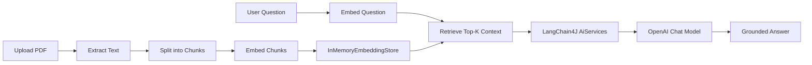

# RAG PDF Chatbot (Spring Boot + LangChain4J)

This project is a Java Spring Boot API for asking grounded questions over uploaded PDF documents.

It uses:

- Spring Boot + Maven
- Controller/Service architecture
- LangChain4J RAG components
- In-memory vector store (`InMemoryEmbeddingStore`)
- OpenAI embedding model + chat model

## What this app does

1. Accepts PDF uploads.
2. Extracts text from the PDF.
3. Splits text into chunks using LangChain4J splitter.
4. Creates embeddings for chunks.
5. Stores embeddings in an in-memory vector database.
6. For each user question, retrieves relevant chunks.
7. Sends question + retrieved context to the chat model.
8. Returns a grounded answer.

## End-to-end flow



## Runtime request flow

### Upload flow (`POST /api/v1/documents/upload`)

1. Controller accepts multipart file.
2. PDF text extraction runs using PDFBox.
3. `EmbeddingStoreIngestor` indexes document chunks into vector store.
4. Response returns filename and indexed chunk count.

### Chat flow (`POST /api/v1/chat`)

1. Request is validated (`question`, `topK`).
2. `EmbeddingStoreContentRetriever` fetches top-k relevant chunks.
3. LangChain4J `AiServices` builds assistant with retriever.
4. Assistant answers using retrieved context.
5. Response returns answer plus retrieved chunk count.

## Setup instructions

### 1. Prerequisites

- Java 17+
- Maven 3.9+
- OpenAI API key

### 2. Configure environment variable

The API key is intentionally not stored in source code.

```bash
export OPENAI_API_KEY="your_openai_api_key"
```

### 3. (Optional) Review model settings

Defaults are configured in `src/main/resources/application.yml`:

- `openai.chat-model: gpt-4o-mini`
- `openai.embedding-model: text-embedding-3-small`
- `openai.temperature: 0.2`

### 4. Run the application

```bash
mvn spring-boot:run
```

The app starts on `http://localhost:8080`.

### 5. Verify health

```bash
curl http://localhost:8080/api/v1/health
```

Expected response:

```text
RAG PDF chatbot is up
```

## API usage

### 1. Upload a PDF

```bash
curl -X POST "http://localhost:8080/api/v1/documents/upload" \
  -F "file=@resources/document.pdf"
```

Example response:

```json
{
  "filename": "document.pdf",
  "chunksIndexed": 8
}
```

### 2. Ask a question

```bash
curl -X POST "http://localhost:8080/api/v1/chat" \
  -H "Content-Type: application/json" \
  -d '{"question":"Will I be compensated if I setup my own office at home using my funds?","topK":4}'
```

Example response:

```json
{
  "answer": "...",
  "retrievedChunks": 4
}
```

## Project structure

- `src/main/java/com/rohity294/ragchatbot/controller`: REST endpoints
- `src/main/java/com/rohity294/ragchatbot/service`: ingestion, retrieval, and chat orchestration
- `src/main/java/com/rohity294/ragchatbot/config`: Spring config and OpenAI properties
- `src/main/java/com/rohity294/ragchatbot/dto`: request/response DTOs
- `src/main/java/com/rohity294/ragchatbot/exception`: centralized API error handling

## Error handling behavior

- Missing or empty API key returns HTTP 400 with guidance.
- Invalid chat input returns HTTP 400 (validation errors).
- Uploading non-PDF files returns HTTP 400.
- Unexpected server failures return HTTP 500.

## Important notes

- Vector storage is in-memory, so indexed embeddings are lost on restart.
- Upload at least one PDF before sending chat requests.
- Retrieval quality depends on document quality and selected `topK`.
