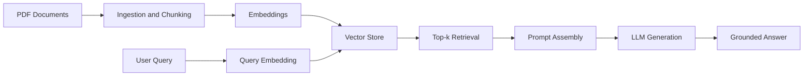

# RAG PDF Chatbot Learning Resources

This folder contains curated reference material for building a Java-based Retrieval-Augmented Generation (RAG) chatbot for PDF documents (LangChain4J-focused).

## Theory-first orientation

Before implementation details, this repository should be understood as a knowledge-grounding system, not only a prompt-to-response system.

In a standard chatbot, the model answers from parametric memory (what it learned during training). In a RAG chatbot, answers are generated from two sources:

- The model's general language capability
- Retrieved evidence from your own document corpus

At a high level, this is the core idea:

If retrieval is weak, even a strong model can produce weak or hallucinatory answers.

## Underlying concepts (high-level)

### 1. Knowledge grounding

Grounding means constraining model outputs to relevant source context. For PDF Q&A, this reduces hallucination and increases trustworthiness.

### 2. Semantic representation

Documents and queries are converted into vectors (embeddings). Similar meaning maps to nearby points in vector space, enabling retrieval by semantic similarity rather than exact keywords.

### 3. Retrieval as a ranking problem

The system does not "find the one true paragraph". It ranks candidate chunks and selects top-k context windows. Good chunking and retrieval strategy often matter more than model size.

### 4. Context-window economics

The LLM has limited context. Retrieval decides what information is worth spending tokens on. This is both a quality and cost optimization problem.

### 5. Generation under constraints

The generation stage is effectively controlled synthesis:

- Use retrieved evidence
- Follow user intent
- Stay coherent and concise
- Avoid unsupported claims

### 6. Evaluation triad mindset

RAG quality is typically measured along three dimensions:

- Context relevance: Did retrieval fetch the right evidence?
- Groundedness: Is the answer actually supported by that evidence?
- Answer relevance: Did the final answer solve the user's question?

## Conceptual architecture

## How theory maps to code decisions

- Chunking strategy maps to retrieval recall and precision.
- Embedding model choice maps to semantic search quality.
- Top-k and reranking map to context quality vs latency/cost.
- Prompt template maps to groundedness and response style.
- Evaluation loop maps to system reliability over time.

The goal is to move from concept to implementation with practical guidance on:

- RAG architecture and evaluation
- Vectors and embeddings fundamentals
- Project planning for a Java proof of concept
- External tutorial references

## Why this repository exists

RAG systems improve LLM responses by retrieving relevant context before generation. For PDF chat use cases, this enables grounded answers based on document content instead of model-only memory.

## Contents

| File | Purpose |
| 
| `Link_Tutorial.md` | Markdown version containing tutorial reference links. |

| `document.pdf` | Sample PDF that can be used for ingestion, chunking, and retrieval experiments. |
| `RAG_Infographic.png` | Visual summary of the RAG pipeline and core concepts. 

1. Open `Link_Tutorial.docx` or `Link_Tutorial.md` and follow the referenced tutorial for practical context.
2. Use `document.pdf` as your first ingestion and QA test asset.

## How to use these resources in implementation

- Ingestion: Parse `document.pdf`, clean text, and split into chunks.
- Embedding: Generate embeddings per chunk using your selected embedding model.
- Storage: Save embeddings in a vector store.
- Retrieval: Fetch top-k relevant chunks for each user query.
- Generation: Provide retrieved context to the LLM and return grounded answers.
- Evaluation: Track context relevance, groundedness, and answer relevance.

## Current status

This folder currently provides planning and learning assets. Application source code is expected to be added in future commits/branches.

## License

This project is licensed under Apache 2.0. See `../LICENSE`.
